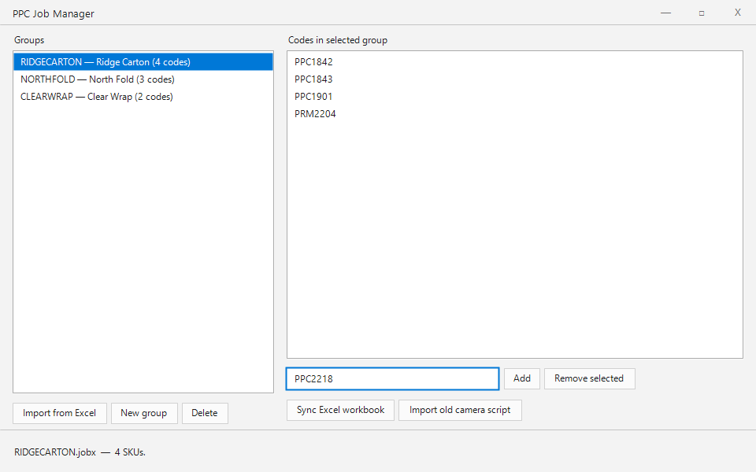
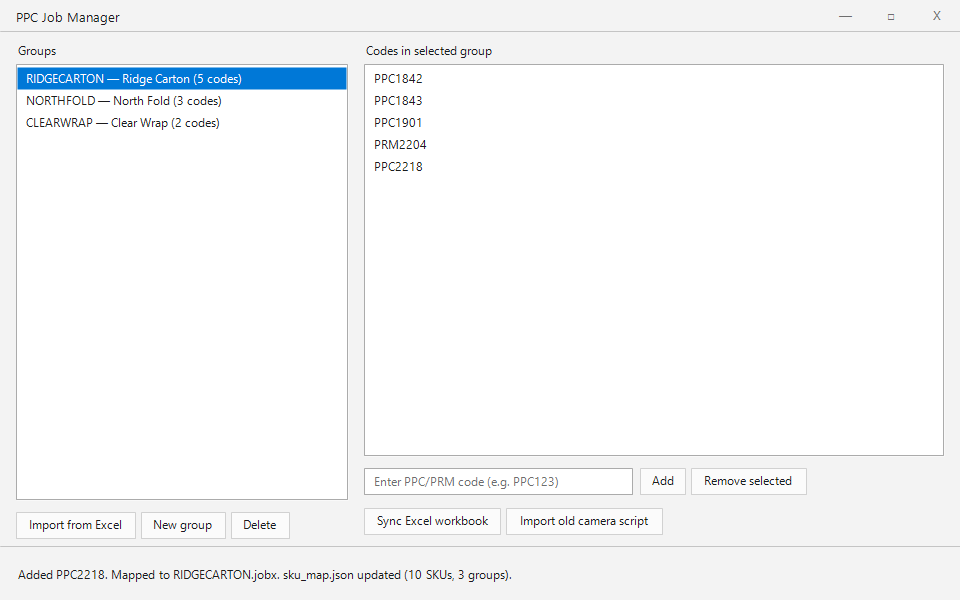
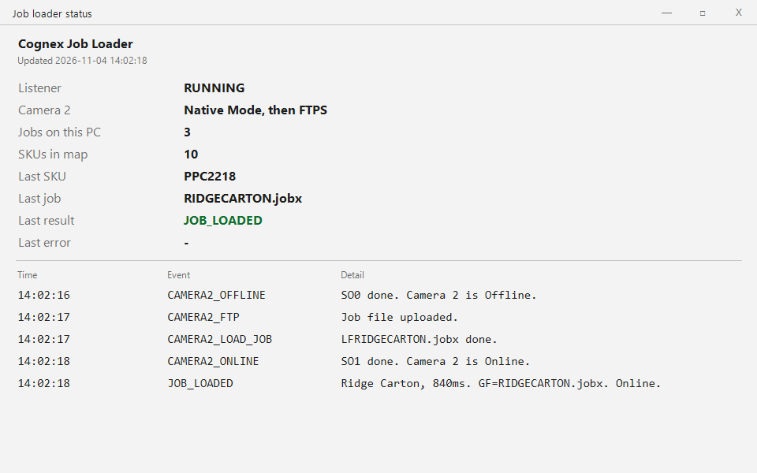

# Smart camera job loader

A Windows app groups printed product codes into Cognex inspection jobs, and a service loads the matching job onto the second camera when the first camera reads a code.

## Stack

<table>
<tr>
<td valign="top" width="50%">

<strong>Frontend</strong>
<ul>
<li>Windows Forms on .NET 10</li>
</ul>

<strong>Languages</strong>
<ul>
<li>C#</li>
<li>PowerShell</li>
<li>JavaScript, for the script that runs on camera 1</li>
</ul>

<strong>Cameras</strong>
<ul>
<li>Cognex In-Sight camera 1 reads the printed code</li>
<li>Cognex In-Sight camera 2 runs one artwork job per code group</li>
<li>Native Mode takes camera 2 offline (SO0), loads the .jobx (LF), checks the active job (GF), then puts it online (SO1)</li>
<li>The same groups write the camera script that sends SO0, the job name, and SO1</li>
</ul>

</td>
<td valign="top" width="50%">

<strong>Backend</strong>
<ul>
<li>.NET 10 Windows service</li>
<li>TCP listener for the code from camera 1</li>
<li>sku_map.json, and the first group in the list wins</li>
<li>FTPS upload of the .jobx onto camera 2 before the load</li>
</ul>

<strong>Frameworks</strong>
<ul>
<li>.NET 10</li>
<li>ClosedXML, so the workbook stays in step with the groups</li>
</ul>

</td>
</tr>
</table>

## Run it

No install. Double-click `Open-Demo.ps1`, or open `demo/index.html` in Chrome or Edge.

The walkthrough plays on its own. PPC2218 is typed into Ridge Carton, the map points that code at RIDGECARTON.jobx, then camera 2 loads the job and comes back online. Replay runs it again.

| What to look at | Result |
| --- | --- |
| Groups | 3 |
| Ridge Carton before the add | 4 codes |
| Code added | PPC2218 |
| Ridge Carton after the add | 5 codes |
| SKUs in the map | 10 |
| Job | RIDGECARTON.jobx |
| Lookup | First group wins |
| Camera 2 | Offline, job uploaded, loaded, then online |
| Last result | JOB_LOADED in 840ms |

